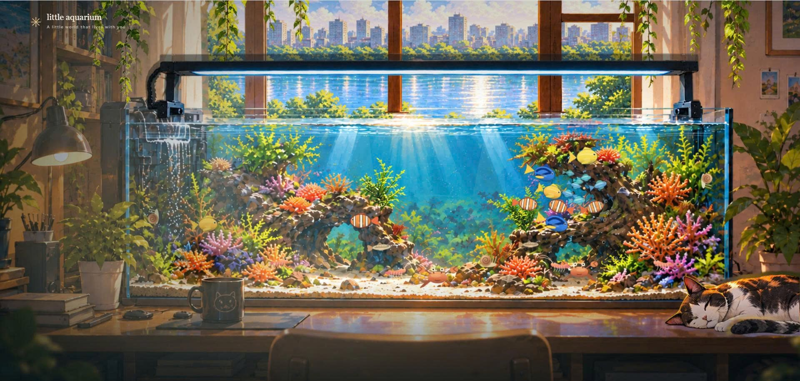

# 🌿 Cozy Aquarium — A Little World That Lives With You

<p align="center">
  <b>Chuyển đổi ngôn ngữ / Switch Language:</b><br>
  <a href="#-tiếng-việt-bản-tiếng-việt"><b>🇻🇳 Tiếng Việt</b></a> &nbsp;•&nbsp;
  <a href="#-english-version"><b>🇬🇧 English</b></a>
</p>

> **Author / Tác giả**: [trinhtienminh2018-tech](https://github.com/trinhtienminh2018-tech)  
> **Version / Phiên bản**: `2.0.0-alpha.8.9.13` (*Multilingual i18n & Audio Stability Patch*)  
> **A cozy, breathing little world that lives with you** — An ambient virtual living space with a lifelike aquarium, lazy cat Miu, realtime day/night cycle, dynamic weather, and calming soundscapes. Ready as a **Live Desktop Wallpaper (Lively Wallpaper)**!

---



---

<details open>
<summary><h2>🇻🇳 Tiếng Việt (Bản tiếng Việt)</h2></summary>

### 🌿 Giới thiệu
**Một góc bình yên ấm cúng sống cùng nhịp thở của bạn** — Mô phỏng căn phòng thư giãn với bể cá thủy sinh sống động, chú mèo Miu lười biếng, chu kỳ thời gian thực, thời tiết biến đổi và âm thanh thiên nhiên êm dịu. Hoàn toàn sẵn sàng làm **Hình nền động Desktop (Live Wallpaper)**!

---

### 🌐 1. Bản địa hóa & Đa ngôn ngữ (Bilingual i18n Support)
* **Tiếng Việt & English**: Tích hợp bộ chuyển đổi ngôn ngữ mượt mà ngay trong bảng **Cài đặt (Settings)** và menu tùy biến **Lively Wallpaper**.
* **Bản địa hóa toàn diện**: Dịch toàn bộ giao diện, tên các loài cá/sinh vật đáy, tooltip, thông báo trạng thái, đồng hồ và hộp thoại.
* **Tự động lưu & Phản ứng tức thì**: Tự ghi nhớ ngôn ngữ ưu tiên (`aquarium2.language`) và áp dụng tự động cho các phần tử sinh ra động bằng `MutationObserver`.

---

### ✨ 2. Điểm nổi bật & Tính năng chính

#### 🐠 Hệ sinh thái bể cá sống động (Living Aquarium Ecosystem)
* **5 loài cá bơi theo đàn**: Neon Tetra, Guppy, Betta, Angelfish... với thuật toán boids mô phỏng chuyển động uốn lượn tự nhiên theo trục xương sống (*spine-driven swimming*).
* **Sinh vật tầng đáy độc lập**: Cua bò ngang, tôm búng lùi, ốc từ tốn bò trên cát và biết tìm chỗ ẩn nấp quanh các rạn san hô.
* **Tương tác thả mồi**: Nhấp chuột vào mặt nước để rắc thức ăn — cá sẽ bơi đến tranh mồi.
* **Vật lý dòng chảy tuần hoàn**: Dòng nước tuần hoàn cuốn hạt thức ăn, bọt khí và bụi nước trôi theo quy luật thủy lưu chân thực.
* **Cây thủy sinh & San hô tách lớp**: Chuyển động đung đưa nhịp nhàng theo dòng nước, có slider tùy chỉnh độ mạnh chuyển động.
* **Hiệu ứng khúc xạ nước**: Ánh sáng khúc xạ đáy bể (*caustics*), các nguồn sục khí oxy tinh tế và các hạt bụi nước phát sáng lơ lửng.

#### ☀️🌙 Chu kỳ thời gian thực & Ánh sáng động (Realtime Day/Night Cycle)
* **Đồng bộ thời gian thực**: Tự động chuyển đổi mượt mà giữa Sáng sớm, Ban ngày, Hoàng hôn và Buổi tối theo đồng hồ máy tính (hoặc chọn thủ công theo ý thích).
* **Ánh sáng tự nhiên qua cửa sổ**: Ánh nắng ban ngày, sắc cam ấm áp lúc chiều tà và ánh trăng xanh dịu đêm muộn xuyên qua khung cửa sổ đổ bóng vào phòng.
* **Đèn bàn học & Đèn LED bể cá**: Bật/tắt công tắc hoặc nhấp trực tiếp vào chiếc đèn/thanh LED; tùy chỉnh độ sáng mượt mà.
* **Chuyển cảnh nguyên tử (Atomic Scene Transition)**: Tự động nạp trước (*preload*) toàn bộ ảnh nền và ánh sáng trước khi chuyển đổi, triệt tiêu hoàn toàn hiện tượng chớp nháy trắng (*white flash/pop-in*).

#### 🌧️⚡ Hệ thống thời tiết & Tương tác cửa sổ (Dynamic Weather)
* **3 chế độ thời tiết**: Quang đãng, Có gió và Mưa giông.
* **Mưa giông chân thực**: 
  * Giọt nước mưa đọng và chảy dài trên mặt kính cửa sổ.
  * Gió thổi làm lay động cành lá bên ngoài.
  * Chớp giật lóe sáng toàn bộ căn phòng kèm tiếng sấm rền xa xa ngẫu nhiên.
* **Đóng / Mở cửa sổ**: 
  * Nhấp vào cửa sổ để mở hoặc đóng với âm thanh then gỗ tự nhiên.
  * Khi mở cửa, tiếng gió và mưa ngoài trời sẽ tràn vào phòng rõ rệt hơn.

#### 🐱 Chú mèo Miu ấm áp (Interactive Miu Life)
* Miu lười biếng nằm ngủ trên bàn cạnh bể cá, có nhịp sinh học tự nhiên theo thời gian trong ngày.
* Tự động cựa mình, đổi tư thế ngủ, vươn vai (*stretch*) và vẫy đuôi.
* **Tương tác vuốt ve**: Nhấp chuột vào Miu để vuốt ve, chú mèo sẽ cất tiếng ngáy gừ gừ (*purr*) nũng nịu.

#### 🎵 Dàn âm thanh Ambient đa kênh thư giãn (Cozy Soundscape)
* Trộn âm thanh nhiều tầng: tiếng lọc nước sủi bọt, chim hót ríu rít, gió thổi, mưa rơi ngoài hiên, tiếng sấm đì đùng xa xăm.
* Nhạc nền tuyển chọn: Các bản lofi êm dịu (thay đổi theo sáng/chiều/tối) và giai điệu piano thư thái.
* **Độ ổn định âm thanh chuyên sâu**:
  * Chống gọi trùng lặp `play()` khi track đang nạp (pending).
  * Bắt lỗi `AbortError` êm ái khi người dùng bật/tắt nhanh, không spam thông báo lỗi kỹ thuật.
  * Xử lý tối ưu chính sách tự động phát nhạc (*Autoplay policy*) của trình duyệt.

#### 🖥️ Sẵn sàng làm Hình nền động Desktop (Live Wallpaper Ready)
* Tích hợp sẵn định dạng của **[Lively Wallpaper](https://rocksdanister.github.io/lively/)** (`LivelyInfo.json`, `LivelyProperties.json`).
* Menu tùy biến trực tiếp trên Desktop: chỉnh Zoom/Full, mức FPS, số lượng cá, bật/tắt âm thanh, chọn ngôn ngữ (Tiếng Việt / English).
* **Chế độ thư giãn (Ambient Mode)**: Tự động ẩn thanh điều khiển sau khi khởi động, thanh công cụ sẽ trượt lên mượt mà khi rê chuột xuống mép dưới màn hình.
* Tương tác nhấp chuột ngay trên Desktop (cho cá ăn, vuốt mèo).

#### ⚡ Tối ưu hóa hiệu năng (Adaptive Render Budget)
* Nhiều mức chất lượng hiển thị: **Tự động**, **Mượt (60 FPS)**, **Cân bằng (30 FPS)**, **Tiết kiệm (20 FPS)**.
* Tự động nhận diện khi chuyển tab hoặc cửa sổ bị che khuất để tạm dừng/giảm tải render, bảo vệ pin laptop và giảm tối đa mức chiếm dụng CPU/GPU.

---

### 🛠️ 3. Công nghệ sử dụng
* **Frontend**: Pure Vanilla JavaScript (ES Modules), HTML5 Canvas, CSS3 Custom Properties (Biến HSL, Glassmorphism, Vignette).
* **Đồ họa**: 2.5D Layered Illustration (Độ phân giải chuẩn 1536×1024, tự co giãn theo tỷ lệ màn hình).
* **Audio**: Web Audio API & HTMLAudioElement đa luồng.
* **Backend Dev**: Node.js HTTP Server siêu nhẹ (hỗ trợ streaming, tự động nhận diện MIME type).
* **Testing & CI**: Node.js Native Test Runner (`node:test`) kiểm thử hồi quy DOM, Audio, i18n và Scene Transition.

---

### 🚀 4. Hướng dẫn cài đặt & Chạy dự án
```bash
# 1. Clone repository
git clone https://github.com/trinhtienminh2018-tech/Little_Aquarium_Alpha_08.9.10_Audio_Stability.git
cd Little_Aquarium_Alpha_08.9.10_Audio_Stability

# 2. Khởi động máy chủ dev cục bộ
npm run dev

# 3. Chạy kiểm thử tự động (9/9 tests)
npm test

# 4. Đóng gói phân phối
npm run build
```
Mở trình duyệt: **`http://localhost:3000`**

---

### 🖼️ 5. Cài đặt làm Hình nền Desktop (Lively Wallpaper)
1. Tải **Lively Wallpaper** (miễn phí trên [Microsoft Store](https://apps.microsoft.com/detail/9ntm2qc6qws7) hoặc [GitHub](https://github.com/rocksdanister/lively)).
2. Kéo thả tệp **`Cozy_Aquarium_Wallpaper.zip`** vào cửa sổ Lively Wallpaper *(hoặc chọn Add Wallpaper ➔ trỏ vào `dist/index.html`)*.
3. Nhấp chuột phải vào hình nền trên Lively để tùy biến ngôn ngữ, thời tiết, FPS, số cá và âm thanh!

---

### 🎮 6. Thao tác điều khiển nhanh

| Thao tác | Tác dụng |
| :--- | :--- |
| **Nhấp vào nước** | Rắc thức ăn cho đàn cá bơi lại ăn |
| **Nhấp vào Miu** | Vuốt ve mèo Miu (kèm tiếng ngáy gừ gừ) |
| **Nhấp vào cửa sổ** | Mở hoặc đóng cửa sổ ngoài trời |
| **Nhấp vào đèn bàn / đèn LED** | Bật hoặc tắt nhanh hệ thống chiếu sáng |
| **Nhấp vào tranh tường** | Mở xem ảnh kỷ niệm Hồ Gươm phóng to |
| **Phím Esc** | Đóng bảng Cài đặt / Bật tắt chế độ Thư giãn (Ambient) |

</details>

<br>

---

<details open>
<summary><h2>🇬🇧 English Version</h2></summary>

### 🌿 Introduction
**A cozy, breathing little world that lives with you** — An ambient virtual living space featuring a lifelike aquarium, lazy cat Miu, realtime day/night cycle, dynamic weather, and calming soundscapes. Ready out-of-the-box as a **Live Desktop Wallpaper (Lively Wallpaper)**!

---

### 🌐 1. Multilingual i18n Support
* **English & Vietnamese**: Seamless language switcher built right into the **Settings panel** and **Lively Wallpaper** customization properties.
* **Full Localization**: Translates all UI labels, fish & bottom creature species, status notifications, clock frames, tooltips, and dialogs.
* **Persistent & Reactive**: Remembers your preferred language in `localStorage` (`aquarium2.language`) and automatically translates dynamically spawned elements using `MutationObserver`.

---

### ✨ 2. Key Features

#### 🐠 Living Aquarium Ecosystem
* **5 Schooling Fish Species**: Neon Tetra, Guppy, Betta, Angelfish... driven by boids algorithms with natural spine-driven swimming motions.
* **Autonomous Bottom Dwellers**: Crabs scuttling sideways, shrimp flicking backward, and snails crawling leisurely across the sand while seeking shelter near coral reefs.
* **Interactive Feeding**: Tap or click anywhere on the water surface to drop food pellets — the fish swim up eagerly to feed.
* **Continuous Circulation Physics**: A slow, coherent recirculating current field guides food pellets, bubbles, and motes realistically.
* **Separated Aquatic Plants & Corals**: Swaying gently with the water current, equipped with independent motion intensity sliders.
* **Water Caustics & Optical FX**: Subtle aeration bubble columns, refractive light beams (*caustics*), and glowing floating motes.

#### ☀️🌙 Realtime Day/Night Cycle & Dynamic Lighting
* **Realtime Synchronization**: Smoothly transitions between Morning, Day, Sunset, and Night following your computer's clock (or select manually).
* **Natural Window Sunlight & Moonlight**: Warm day sunlight, golden sunset hues, and soothing blue moonlight streaming through the window into the room.
* **Desk Lamp & Aquarium LED Lighting**: Toggle on/off or click directly on the lamp/LED bar; smoothly adjust brightness sliders.
* **Atomic Scene Transitions**: Preloads all target panoramas and lighting art before committing, completely eliminating white flashes or asset pop-in.

#### 🌧️⚡ Dynamic Weather & Window Interaction
* **3 Weather Modes**: Clear, Windy, and Thunderstorm.
* **Atmospheric Thunderstorm**:
  * Realistic raindrops condensing and running down the window pane.
  * Gusty winds rustling outdoor vines and foliage.
  * Localized lightning flashes illuminating the room accompanied by distant thunder rolls.
* **Interactive Window**:
  * Tap the window to latch/unlatch with authentic wooden latch acoustics.
  * Opening the window lets exterior wind and rain ambience flow naturally into the room.

#### 🐱 Interactive Miu Life
* Miu the cat naps peacefully on the desk beside the aquarium with organic biological rhythms.
* Spontaneously adjusts sleeping postures, stretches, and flicks its tail.
* **Petting Interaction**: Tap or click Miu to pet her — she responds with a comforting, gentle purr.

#### 🎵 Multi-Track Ambient Soundscape
* Layered natural audio mix: aquarium water trickle, aeration bubbles, morning birds, gentle wind, rustling leaves, and rain.
* Curated soundtracks: Calming lofi tracks that shift between morning, afternoon, and night, plus gentle piano melodies.
* **Hardened Audio Engine**:
  * Prevents duplicate `play()` invocations while audio tracks are pending.
  * Gracefully handles `AbortError` during rapid toggles without noisy toast popups.
  * Seamlessly respects browser autoplay policies.

#### 🖥️ Live Desktop Wallpaper Ready
* Fully packaged for **[Lively Wallpaper](https://rocksdanister.github.io/lively/)** (`LivelyInfo.json`, `LivelyProperties.json`).
* In-app desktop customization: Zoom/Full mode, FPS limit, fish count, audio toggle, and language (English / Tiếng Việt).
* **Ambient Mode**: Auto-fades controls on launch; toolbar slides up smoothly when hovering at the bottom of the screen.
* Retains full mouse interaction on your desktop (feed fish, pet Miu).

#### ⚡ Adaptive Render Budget
* Multiple animation quality tiers: **Auto**, **Smooth (60 FPS)**, **Balanced (30 FPS)**, **Eco (20 FPS)**.
* Automatically throttles or pauses rendering when switching tabs or when the window is occluded to conserve CPU, GPU, and laptop battery.

---

### 🛠️ 3. Tech Stack
* **Frontend**: Pure Vanilla JavaScript (ES Modules), HTML5 Canvas, CSS3 Custom Properties (HSL variables, Glassmorphism, Vignette).
* **Artwork**: 2.5D Layered Illustration (1536×1024 native canvas resolution, auto-scaling to any display aspect ratio).
* **Audio**: Multi-channel Web Audio API & HTMLAudioElement architecture.
* **Dev Server**: Lightweight Node.js HTTP server (streaming support, automatic MIME detection).
* **Testing & CI**: Native Node.js Test Runner (`node:test`) for DOM, Audio, i18n, and Scene Transition regressions.

---

### 🚀 4. Installation & Setup
```bash
# 1. Clone repository
git clone https://github.com/trinhtienminh2018-tech/Little_Aquarium_Alpha_08.9.10_Audio_Stability.git
cd Little_Aquarium_Alpha_08.9.10_Audio_Stability

# 2. Start local development server
npm run dev

# 3. Run automated regression tests (9/9 passed)
npm test

# 4. Build distribution bundle
npm run build
```
Open your browser at: **`http://localhost:3000`**

---

### 🖼️ 5. Setting Up as Live Wallpaper (Lively Wallpaper)
1. Install **Lively Wallpaper** (free on [Microsoft Store](https://apps.microsoft.com/detail/9ntm2qc6qws7) or [GitHub](https://github.com/rocksdanister/lively)).
2. Drag and drop **`Cozy_Aquarium_Wallpaper.zip`** into the Lively Wallpaper window *(or click Add Wallpaper ➔ point to `dist/index.html`)*.
3. Right-click the wallpaper in Lively to customize language, weather, FPS, fish count, and audio!

---

### 🎮 6. Controls & Shortcuts

| Action | Effect |
| :--- | :--- |
| **Click on water** | Drop food pellets for the schooling fish |
| **Click on Miu** | Pet Miu the cat (triggers purring audio) |
| **Click on window** | Open or close the wooden window |
| **Click desk lamp / LED** | Quickly toggle lights on or off |
| **Click wall photo** | View framed memory photo of Hanoi |
| **Esc key** | Close Settings / Toggle Ambient mode |

</details>

---

## 📄 Giấy phép / License

Released under the open-source [MIT License](LICENSE).  
Copyright (c) 2026 [trinhtienminh2018-tech](https://github.com/trinhtienminh2018-tech).  
Contributions, suggestions, and feedback are always welcome! 🌸
